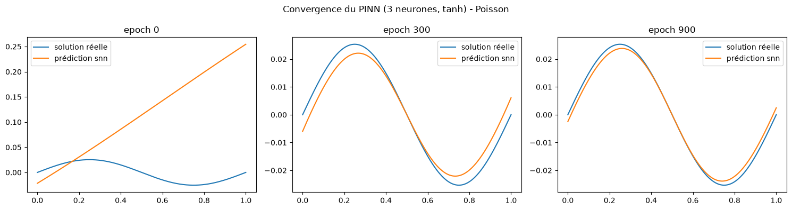
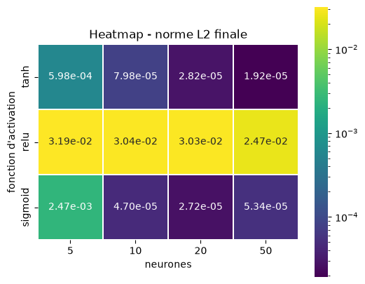
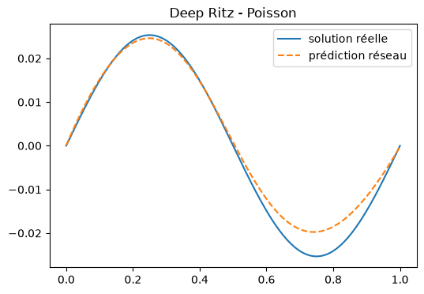

# Neural networks for solving partial differential equations

First-year project at École des Ponts (2026), at the CERMICS lab, supervised by Sofiane Ezzehi.

Authors: Paul Rivaud, Timoté Missaye, Soufiane Ait Abbou, Pierre Kairo.

We solve two 1D partial differential equations, the Poisson equation and the modified Helmholtz equation, with neural networks. We compare two methods: PINN, which minimizes the residual of the equation and the error on the boundary conditions, and Deep Ritz, which minimizes the energy that comes from the variational formulation.

## How to run

```bash
python -m venv venv
venv\Scripts\activate
pip install -r requirements.txt
jupyter notebook notebooks/demo.ipynb
```

Running the whole notebook takes about 7 minutes on a laptop.

Each file in `src/` can also be run on its own to check that it works, for example `python -m src.train_pinn`.

## Results



With only 3 neurons, the PINN gets close to the exact solution in 1000 epochs.



Tanh and sigmoid work well. ReLU does not: its second derivative is zero almost everywhere.



Deep Ritz is much slower: the error stays around 0.016 until epoch 8000, then drops to about 0.003.

## References

1. M. Raissi, P. Perdikaris and G.E. Karniadakis, Physics-informed neural networks: A deep learning framework for solving forward and inverse problems involving nonlinear partial differential equations, Journal of Computational Physics, 2019.
2. W. E and B. Yu, The Deep Ritz method: A deep learning-based numerical algorithm for solving variational problems, 2017.

Full report: [report/rapport_PINN.pdf](report/rapport_PINN.pdf). The code was corrected after the report, so some numbers differ from the PDF.
